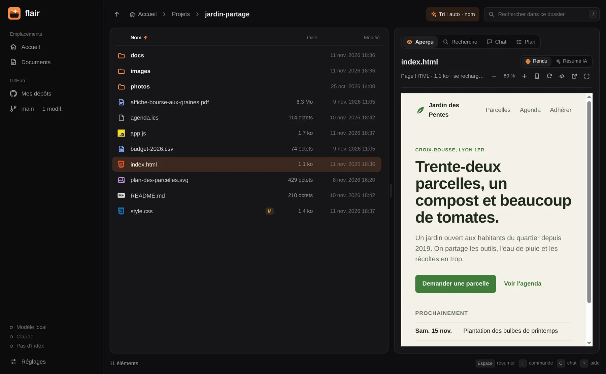

# Flair

Un explorateur de fichiers pour Vex qui lit, cherche, range et répond grâce à l'IA,
entièrement au clavier.



Une application de [la suite flair](https://vexlab-off.github.io/mon-portfolio/flair/), avec [flair](https://github.com/vexlab-off/flair),
[Flair Code](https://github.com/vexlab-off/flaircode) et [Flair Web](https://github.com/vexlab-off/flairweb).

## Installer

Sur Arch Linux et ses dérivées, avec le paquet de la
[dernière version](https://github.com/vexlab-off/flair/releases/latest) :

```sh
sudo pacman -U flair-0.2.0-1-x86_64.pkg.tar.zst
```

Ou en construisant le paquet soi-même depuis les sources de la version :

```sh
git clone https://github.com/vexlab-off/flair
cd flair/packaging/arch
makepkg -si
```

Il faut Qt 6 (base, declarative, webengine, multimedia, wayland) et git. En option : poppler (PDF), github-cli, un modèle local (Ollama ou LM Studio).


- **Aperçu des médias** : un clic sur une image l'affiche (dimensions, transparence) ; sur
  une musique ou une vidéo, un lecteur s'ouvre avec la durée, la résolution et les tags
  (titre, artiste, album, genre).
- **Aperçu** : Espace affiche une page HTML rendue (CSS, JavaScript, rechargement
  automatique à chaque enregistrement, zoom, largeur mobile, `F` pour agrandir), et résume
  par l'IA tout le reste (texte, code, PDF). `flair page.html` ouvre directement l'aperçu.
- **Recherche par le sens** : `I` indexe le dossier avec un modèle d'embeddings local,
  puis `/` trouve « la facture d'électricité de l'an dernier » sans connaître son nom.
  Sans index, la recherche porte sur les noms.
- **Commandes en langage naturel** : `:` puis « range les captures d'écran par mois »
  produit un plan de déplacements et renommages que tu valides avec Ctrl+Entrée.
- **Rangement automatique** : `S` range par type sans IA ; Maj+S demande un rangement
  intelligent à l'IA.
- **Chat avec un dossier** : `C` pose des questions ; avec un index, les fichiers
  pertinents sont lus pour répondre.
- **Dossier GitHub** : dans la barre latérale (ou Ctrl+G), tes dépôts GitHub s'affichent
  comme un dossier. Ceux déjà clonés sur la machine sont reconnus ; Entrée ouvre le clone,
  ou clone le dépôt dans `~/Work` (réglable) puis l'ouvre. Espace résume le README.
- **Git** : statut des fichiers dans la liste, `D` explique les changements en cours et
  propose un message de commit, `G` ouvre le dépôt sur GitHub.

- **Ouvrir** : un clic, un double-clic ou Entrée sur une page HTML l'affiche rendue dans
  flair (réglable : éditeur ou navigateur). Le code s'ouvre dans ton éditeur (VS Code par
  défaut) ; `E` y ouvre n'importe quel fichier ou dossier.
- **Tri automatique** : par défaut, la liste choisit son ordre selon le dossier : les plus
  récents en haut dans Téléchargements, Images, Vidéos, Bureau et les captures, par nom
  ailleurs. Clique sur une colonne pour trier par nom, taille ou date (re-clique pour
  inverser), ou utilise le bouton « Tri » et la touche `O`.

Les fichiers de code portent le vrai logo de leur langage. L'accent est orange par défaut ;
les réglages proposent d'autres couleurs ou de suivre le thème Vex. Le logo existe en trois
styles (plein, sombre, clair) et suit la couleur partout, jusqu'aux icônes de flair et de
Flair Code dans le lanceur (fichiers dans `~/.local/share/applications`, retirés si l'option
est désactivée).

## Sécurité des fichiers

Les plans ne peuvent que créer des dossiers et déplacer ou renommer. Ils ne suppriment
rien, n'écrasent rien et ne sortent jamais du dossier courant, même via un lien symbolique.
Rien ne bouge avant validation. Si une étape échoue, tout ce qui a déjà été fait est
défait. Ctrl+Z annule un plan appliqué.

## Moteurs IA

| Tâche | Par défaut | Réglable |
|---|---|---|
| Résumés | local | oui |
| Chat, plans, Git | Claude (`claude-opus-5-5`) | oui |
| Embeddings | local | non |

- **Local** : n'importe quel serveur compatible OpenAI. LM Studio (`http://localhost:1234`,
  onglet Developer → Start Server) ou Ollama (`http://localhost:11434`). Pour la recherche
  par le sens, charge un modèle d'embeddings comme `nomic-embed-text`.
- **Claude** : exporte `ANTHROPIC_API_KEY`, ou saisis la clé dans les réglages (Ctrl+,).
  Elle est alors stockée dans `~/.config/flair/flair.conf`, en mode 0600.

Si un moteur manque, la fenêtre le dit et explique quoi faire.

## Raccourcis

| Touche | Action |
|---|---|
| ↑ ↓ / J K | Se déplacer |
| Entrée / → / L | Ouvrir (HTML : aperçu, code : éditeur) |
| O | Changer le tri |
| E | Ouvrir dans l'éditeur de code |
| Retour / ← / H | Dossier parent |
| ~ | Dossier personnel |
| Ctrl+L | Aller à un chemin |
| . | Fichiers cachés |
| Espace | Aperçu : page HTML rendue, sinon résumé par l'IA |
| F | Agrandir l'aperçu HTML |
| / | Rechercher |
| I | Indexer ce dossier |
| C | Discuter avec ce dossier |
| : ou Ctrl+K | Commande en langage naturel |
| S | Ranger par type |
| Maj+S | Rangement intelligent (IA) |
| Ctrl+Entrée | Appliquer le plan |
| Échap | Fermer, abandonner le plan, arrêter l'IA |
| D | Expliquer les changements Git |
| G | Ouvrir le dépôt sur GitHub |
| Ctrl+G | Dossier GitHub (et retour) |
| R | Recharger les dépôts (dossier GitHub) |
| Ctrl+Maj+G | Cloner un dépôt par son nom |
| Clic droit / Menu | Actions sur le fichier ou dossier |
| F2 | Renommer |
| Suppr | Mettre à la corbeille |
| Ctrl+Maj+N | Nouveau dossier |
| Alt+Entrée | Propriétés |
| Ctrl+Z / Ctrl+Maj+Z | Annuler / rétablir |
| 1 2 3 4 | Aperçu, recherche, chat, plan |
| Ctrl+, | Réglages |
| ? | Aide |
| Q | Quitter |

## Flair Image et Flair Vidéo

Deux applications de la suite, dans le même programme, avec leur entrée dans le lanceur :

- **Flair Image** (`flair --image fichier`) : les images du dossier une à une (← →), zoom
  à la molette, ajuster / taille réelle (0 / 1), rotation d'affichage (R), diaporama (S),
  miniatures, informations (I), plein écran (F), corbeille (Suppr, avec confirmation).
- **Flair Vidéo** (`flair --video fichier`) : vidéos et musique du dossier enchaînées,
  Espace/K lecture, ← → 5 s, J L 10 s, 0–9 pour sauter, vitesse [ ], boucle (B), liste de
  lecture (Tab), plein écran (F) ; les contrôles disparaissent pendant la lecture. Pour la
  musique : titre, artiste, album et genre.

Depuis flair, Entrée ou un double-clic ouvre les images et les vidéos dedans (réglable).

## Mode clair et sombre

Réglages → Apparence : Automatique (suit Vex), Clair ou Sombre, pour flair, Flair Code,
Flair Image et Flair Vidéo. Les couleurs des types de fichiers et des dossiers sont
assombries en clair pour rester lisibles ; la couleur des dossiers se choisit (accent, gris
ou une autre).

« Synchroniser les couleurs de la suite flair » (activé par défaut, dans flair comme dans
Flair Code) partage l'accent, le mode, la couleur des dossiers et le style du logo entre les
quatre applications : un changement dans l'une s'applique aux autres.

## Clic droit

Sur un fichier ou un dossier : ouvrir, résumer, ouvrir dans l'éditeur ou un terminal,
copier le chemin, renommer (F2), mettre à la corbeille (Suppr, Ctrl+Z la récupère),
propriétés (Alt+Entrée). Sur un dossier, la partie **Git et GitHub** initialise un dépôt,
le publie sur GitHub (privé par défaut), fait un commit et un push avec un message suggéré
par l'IA, et crée les fichiers du dépôt : `.gitignore` adapté au projet, `README.md` rédigé
par l'IA et relu par toi, `LICENSE` MIT. Rien d'existant n'est jamais remplacé.

## Explorateur du système

Dans les réglages, « Explorateur de fichiers par défaut » fait ouvrir les dossiers par flair
et lui fait répondre à « Afficher dans le dossier » des autres applications (le service D-Bus
`org.freedesktop.FileManager1`). Désactiver rétablit l'explorateur précédent.

Le dossier GitHub utilise l'outil `gh` (`gh auth login` une fois).

## Développement

```sh
bin/build      # build/flair
bin/test       # tests Qt Test, hors écran
bin/install    # paquet Arch : lanceur, icône
```

`FLAIR_SNAPSHOT=capture.png QT_QPA_PLATFORM=offscreen build/flair chemin` enregistre une image
de la fenêtre sans l'afficher.

## Licence

MIT, voir [LICENSE](LICENSE). La suite flair est créée par vex.
